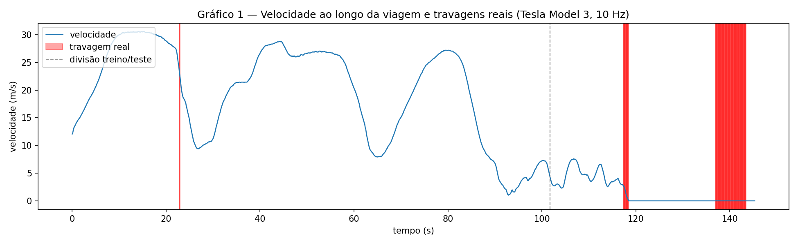
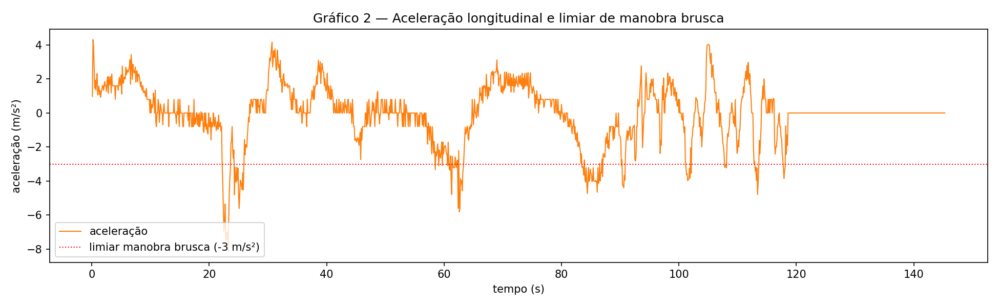
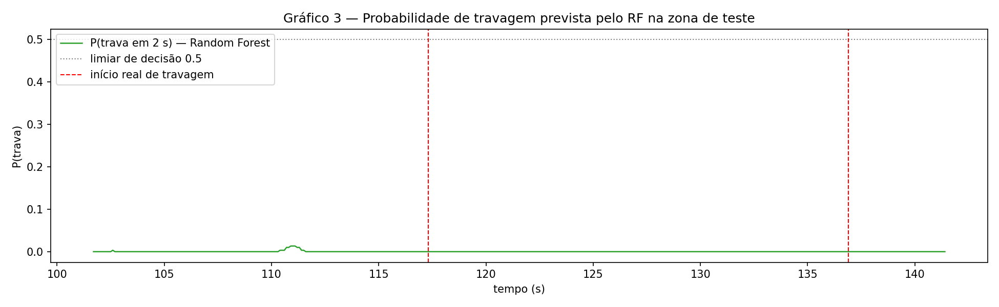

# ADAS — Telemetria e Segurança em Robotáxis (Tesla e Waymo)

**Estudo de engenharia de dados sobre telemetria e segurança em robotáxis e sistemas ADAS avançados, a partir de gravações reais de sensores de um Tesla Model 3 instrumentado** (CAN bus, IMU, LiDAR, GNSS, câmara). O notebook decodifica a telemetria bruta, constrói features de condução, treina modelos de previsão de travagens iminentes (função de segurança tipo FCW — Forward Collision Warning) e responde a sete perguntas de investigação (P1–P7) com base nos dados.

> **Publicado no Kaggle:** [ADAS — Telemetria e Segurança em Robotáxis (Tesla e Waymo)](https://www.kaggle.com/code/gonaldomichael/adas-telemetria-seguran-a-robot-xis-tesla-e-waymo)

## Objectivo do estudo

1. **Dinâmica do veículo** — decodificar telemetria CAN/IMU de um Tesla Model 3 real (velocidade, volante, pedal de travão);
2. **Previsão de manobras críticas** — prever travagens iminentes nos próximos 2 s com base nos 2 s anteriores;
3. **Percepção de objectos** — detectar objectos à frente via LiDAR (a classificação de peões/ciclistas com o robotaxi L4 da Waymo fica documentada como extensão natural, com as limitações registadas no notebook);
4. **KPIs de segurança e operação** — TTC/near-miss, taxa de travagens bruscas por 100 km, conforto (jerk) e latência de inferência.

**Contexto:** o foco narrativo é o Tesla Cybercab/Robotaxi (transporte totalmente autónomo por visão computacional, sem volante nem pedais). Como a Tesla não publica telemetria do Cybercab, o estudo usa a única fonte Tesla real disponível — um Model 3 instrumentado com CAN + LiDAR + 4 câmaras (tfoldi/tesla3_av_rosbags, licença MIT).

## Dataset

| Ficheiro | Conteúdo | Tamanho |
| --- | --- | --- |
| `data/bag/rosbag2_2024_02_10-14_24_59_0.mcap.part00–11` | Bag ROS2/MCAP original do Tesla Model 3 (2024-02-10, ~145 s, 10 Hz): CAN via `/from_can_bus`, LiDAR VLP-16, IMU, GNSS RTK. Dividido em 12 partes (limite de 100 MB/ficheiro do GitHub) | ~1,1 GB |
| `data/bag/tesla_model3_party.dbc` | DBC da Tesla para descodificar as mensagens CAN (volante, travão, velocidade) | 35 KB |
| `data/df_features.csv` | Dataset derivado (1454 linhas × 18 colunas): velocidade, aceleração, volante, pedal, distância do objecto à frente, manobra brusca — reproduz os STEPs 4–7 sem precisar do bag | 351 KB |

Para reunir o bag original (Linux/macOS):

```bash
cat data/bag/rosbag2_2024_02_10-14_24_59_0.mcap.part* > rosbag2_2024_02_10-14_24_59_0.mcap
sha256sum -c data/bag/SHA256SUMS.txt   # verificação de integridade
```

## Estrutura

* `adas-telemetria-e-seguranca-em-robotaxis.ipynb` — estudo completo (19 células): Introdução, STEP 1 (métricas de sucesso e KPIs), STEP 2 (inspecção dos dados brutos), STEP 3/3B (parsing CAN + IMU + LiDAR), STEP 4 (features), STEP 5 (divisão temporal), STEP 6 (Random Forest), STEP 6B (LSTM), STEP 7 (visualização e conclusões), P1–P7 (perguntas de investigação), Conclusão (dados obtidos, modelos e algoritmos, lições de engenharia, limitações)
* `images/` — os 3 gráficos do estudo
* `data/` — dataset bruto (bag em partes + DBC) e derivado (CSV)

## Os 3 gráficos

**Gráfico 1** — velocidade ao longo da viagem com as travagens reais assinaladas a vermelho e a divisão treino/teste:



**Gráfico 2** — aceleração longitudinal e o limiar de manobra brusca (-3 m/s²):



**Gráfico 3** — probabilidade de travagem prevista pelo Random Forest na zona de teste, com os inícios reais de travagem:



## Resultados

**Métricas (alvo do projecto: recall >= 0,80, F1 >= 0,75, antecedência >= 1,0 s):**

| Modelo | Recall | Precisão | F1 | Observação |
| --- | --- | --- | --- | --- |
| Random Forest | 0,00 | 0,00 | 0,00 | prevê sempre “não trava” (accuracy = baseline 0,71) |
| LSTM (CPU) | 0,10 | 0,28 | 0,15 | ~12 verdadeiros-positivos em 116 travagens; prob. máx. 0,657 |

**Respostas P1–P7:**

| P | Pergunta | Resposta em uma linha |
| --- | --- | --- |
| P1 | Condições de velocidade/aceleração nas travagens | 3 eventos: t=22,8 s a 23,6 m/s com -7,46 m/s² (0,2 s); t=117,3 s a 2,8 m/s com -3,84 m/s² (1,2 s); t=136,9 s travão de imobilização (6,6 s) |
| P2 | O volante antecipa a travagem? | Sinal presente (|volante| 121° antes de travar vs 69,5° normal; rotação 41,6 vs 24,1 °/s) mas o RF pesa sobretudo distância (0,537) e velocidade (0,280) |
| P3 | Objectos à frente vs travagem | À frente nas travagens: 8,7 m e aproximação 1,09 m/s vs 16,9 m / 0,16 m/s em condução normal; o LiDAR não classifica o tipo de objecto |
| P4 | ACC/lane keeping e travagens bruscas | Não respondível: 116 amostras bruscas em 145,4 s, mudanças de velocidade [1,0; 4,0], mas o CAN não expõe estado ACC/LKA |
| P5 | Padrões por hora/tipo de estrada | Não respondível: um único bag (sábado 13:25 UTC, via rápida ~50 km/h); exige frota — exactamente a vantagem operacional da Waymo |
| P6 | Antecedência suficiente para um FCW? | Não: RF recall 0,00 vs alvo 0,80, antecedência não mensurável; causa raiz é o treino (21 janelas positivas num único bag), não a arquitectura |
| P7 | Falsos positivos/negativos | Erro dominante é o FALSO NEGATIVO (116 vs 0 FP) — o mais perigoso num ADAS; recomendação: FCW por regras físicas (TTC < 2 s) como camada de segurança |

## Como reproduzir

1. `pip install -r requirements.txt`
2. Reunir o bag: `cat data/bag/rosbag2_2024_02_10-14_24_59_0.mcap.part* > rosbag2_2024_02_10-14_24_59_0.mcap` (ou usar directamente `data/df_features.csv` para os STEPs 4–7)
3. Executar o notebook por ordem (os STEPs 3–6 dependem do bag; os restantes do CSV)

O notebook foi executado em Databricks (serverless, Python 3); a única célula de instalação é `%pip install -q mcap cantools` no início do STEP 3 e `%pip install -q torch --index-url https://download.pytorch.org/whl/cpu` no STEP 6B.

## Nota de honestidade

* Um único bag de ~145 s (bag de conveniência, 21 janelas positivas no treino vs 116 no teste) — os resultados não são generalizáveis a uma frota;
* O LiDAR frontal (sector ±12°) não vê objectos laterais nem classifica o tipo (peão/ciclista/veículo) — a extensão natural é o dataset Waymo motion;
* O CAN decodificado não expõe o estado do ACC/lane keeping;
* Sem GPU disponível: a LSTM foi treinada em CPU (documentado no notebook);
* Um FCW por regras de física (TTC < 2 s) seria mais fiável do que o modelo treinado com estes dados — e coexiste com ele num robotaxi real como camada de segurança.

## Kaggle

Este estudo está publicado no Kaggle: **[ADAS — Telemetria e Segurança em Robotáxis (Tesla e Waymo)](https://www.kaggle.com/code/gonaldomichael/adas-telemetria-seguran-a-robot-xis-tesla-e-waymo)** — notebook end-to-end com o dataset real do Tesla Model 3.

Para reproduzir no Kaggle a partir deste repositório: File → Import Notebook (URL do `.ipynb` deste repo) → Settings → **Internet: ON** (o STEP 2 descarrega o bag de ~1,1 GB da HuggingFace e o DBC do GitHub).

## Licença

MIT (código e notebook). O dataset fonte (tfoldi/tesla3_av_rosbags) é distribuído sob licença MIT pelo autor original; o DBC `tesla_model3_party.dbc` provém do projecto openpilot/opendbc.